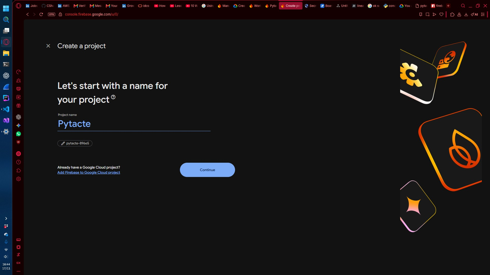
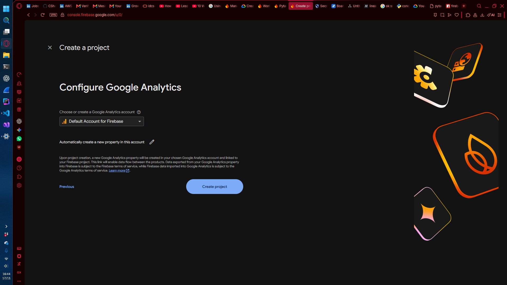

# Pytacte frontend

The frontend is in the `Pytacte-ui/pytacte` directory of the repository. Its dependencies are declared in `package.json`, and `package-lock.json` is committed so npm can install the same dependency versions after cloning.

Before following these steps, install [Node.js](https://nodejs.org/) 20.19+ (or 22.12+).

## Initialising Firebase cloud services

The app uses **Firebase Authentication** for user sign-in, **Firebase Realtime Database** to retrieve transcription server details, and **Firebase Hosting** to publish the frontend. The repository already contains the Firebase CLI project configuration; each developer must connect it to their own Firebase project and generate their Web App configuration.

### Setting up the Firebase console

1) Create a Firebase project in the Firebase Console.


<br/>


<br/>
<br/>

2) Register a **Web App** inside that Firebase project. From the project overview, select the Web icon (`</>`), enter **Pytacte** as the app nickname, and register it. Creating the project and registering its Web App are separate steps. The frontend needs the Web App SDK configuration at `src/data/firebase_config.json`; step 6 generates this file for your project.

3) Enable the app's **Authentication providers**. In the Firebase Console, open **Authentication → Sign-in method** and enable **Email/Password** and **Google**. Use your own support email for Google Sign-In. These providers are also declared in `firebase.json`, and the deployment in step 6 applies that configuration to your project, so keep the console settings and file in sync.

4) Create a **Realtime Database** for the project. In the Firebase Console, open **Databases & Storage → Realtime Database**, select **Create database**, and choose a database location. The repository's `database.rules.json` will be deployed in step 6, so review those rules before deployment.

5) The cloned repository is already initialised for Firebase: it includes `firebase.json`, `.firebaserc`, and the Realtime Database rules. **Do not run `firebase init` in this clone**; reinitialising a selected service can replace its existing configuration with defaults.

6) Install the **firebase-tools** package with npm, sign in, select the Firebase **project** (not the Web App), generate the Web App config, build the frontend, and deploy. Before deploying, change the `supportEmail` under `auth.providers.googleSignIn` in `firebase.json` to the same support email you used in step 3. When `firebase use --add` asks for an alias, choose `dev`, then activate it with `firebase use dev`. The SDK config command selects the only Web App automatically; if there are multiple Web Apps, the CLI prompts you to choose one—select **Pytacte**.

```bash
cd Pytacte-ui/pytacte
npm install -g firebase-tools
firebase login
firebase use --add
firebase apps:sdkconfig WEB --out src/data/firebase_config.json
npm ci
npm run build
firebase deploy
```

`firebase deploy` deploys all configured Firebase resources in this project: Hosting, Authentication provider settings, and Realtime Database rules. The rules in `database.rules.json` replace the rules currently published in the Firebase console, so review that file before deploying.
<br/>
<br/>

## Install and run

Then, from the repository root, run:

```bash
cd Pytacte-ui/pytacte
npm ci
npm run dev
```

`npm ci` installs the frontend dependencies from the lockfile. To add or update a dependency, run `npm install <package>` in this directory and commit both `package.json` and `package-lock.json`.

The development server is available at `http://localhost:3000`.

## Enable the transcription service

Go in the backend application located in the ```Pytacte/pytacte-py``` folder and follow the configuration in the 'README.md' file to enable the backend for transcription.

