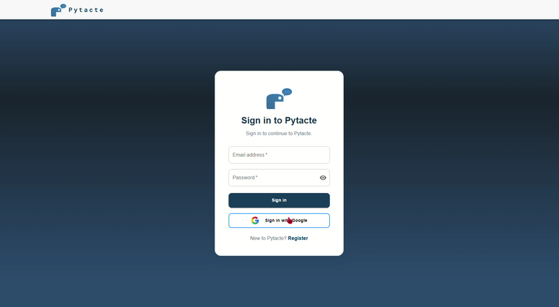
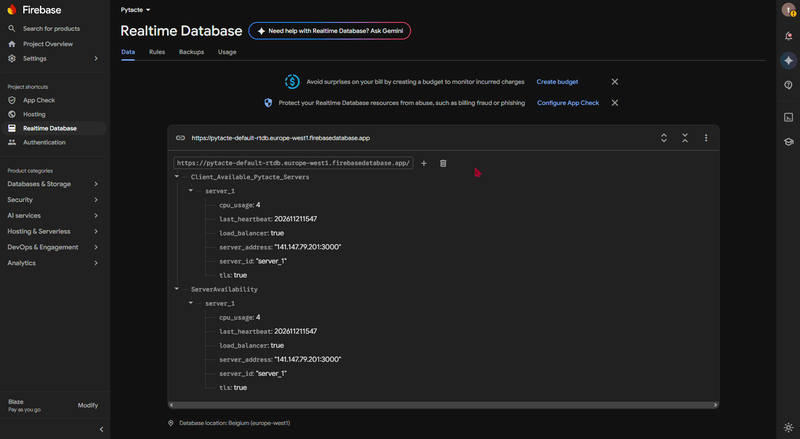
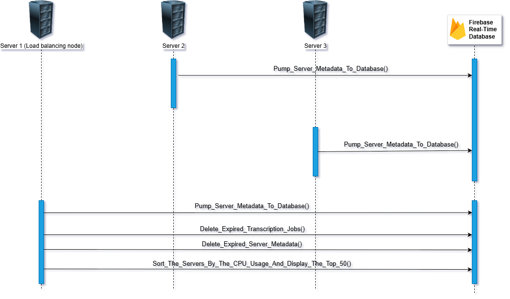
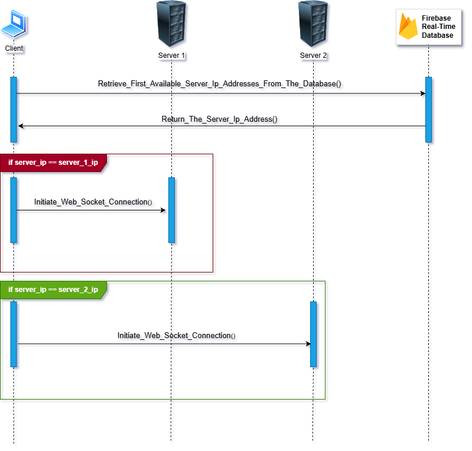
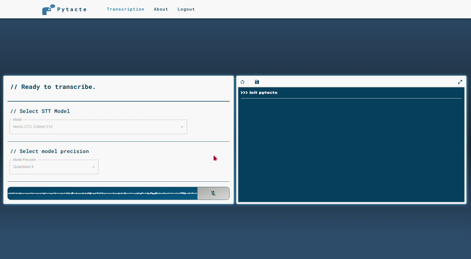
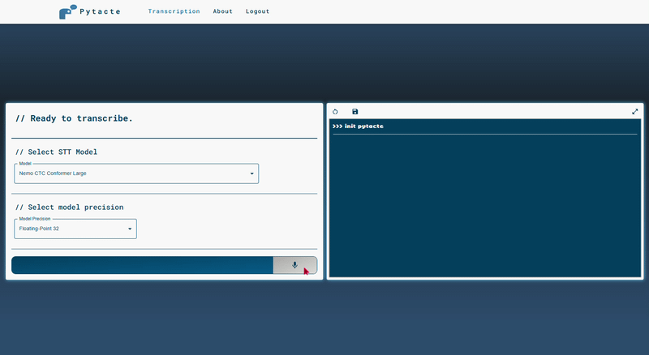
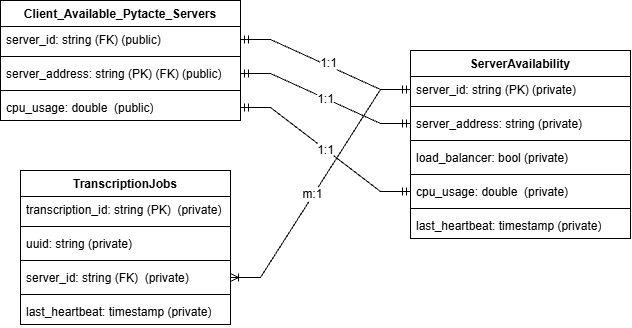

<p align="center">
  
</p>

<br/>
<br/>
<br/>

## Pytacte: Cross-platform speech-to-text app

Pytacte is a multi-user fully secure cross platform speech recognition platform. It is using **🔥Firebase** for authentication and real-time information management, **🤖 Sherpa-ONNX** for streaming multi-client STT AI model inference backend, and **🔐 Google Secrets** for Firebase Admin SDK credential management.

The project is hosted [here](https://pytacte.web.app) where is up, operational, and ready to use.

## Technologies

The frontend is written with **React ⚛️**, **🎨 MUI (Material UI)**, and **TanStack Router 🧭** for dynamic rendering, stateful components, and dynamic routing. The backend is written in **🐍 Python**
and is using the **🔥Firebase Admin SDK** for managing authentication sessions and load balancing states, and **🔐 Google Secrets** for Firebase Admin SDK credentials.

## Backend architecture 🏗️

Pytacte uses a **configuration-driven hybrid architecture** ⚙️. Depending on its configuration, the server can run as a monolith or as part of a microservices deployment.

In a multi-server deployment, servers publish their availability and CPU usage to Firebase. A load-balancing node removes expired records, ranks servers by CPU usage, and keeps the 50% with the lowest usage in a client-readable table. Clients use that table to select a server. 📊

## Setup

For the deployment in production and/or development environments, the client application must be set up firstly, and the backend application must be set up secondly. The instructions mentioned bellow cover all settings regarding **🔐 Google Secrets**, **🔥Firebase**, configurations, and **🤖 Sherpa-ONNX**.

* Frontend setup: [frontend setup 💻](./Pytacte-ui/pytacte/README.md) 
* Backend setup: [backend setup ⚙️](./Pytacte-py/README.md)

## Features

### Speech-to-Text model selection
_____________________________

<p align="left">
  
  
</p>

The Speech-To-Text AI Models can be selected by each user as well as their precisions. The available precisions are **Quantised 8** and **Floating-Point 32**, where **Quantised 8** offers greater speed but lower accuracy and **Floating-Point 32** offers greater precision but lower latency. **Quantised 8** models use **8-bit model weights** for representing model parameters, whereas **Floating-Point 32** 
uses **32-bit model weights**. An **8-bit model weight** will represent data using less information
but struggle to represent more nuanced parameters, whereas the **32-bit model weights** can represent
more nuanced parameters at the cost of inference speed.

<br/>
<br/>

### Account authentication
_________________________________

<p align="left">
  
  
</p>

#### Authentication features
__________________________________

The authentication workflow uses a custom build stateful notification system built using **🎨 MUI (Material UI)** that allows the application to show authentication states. The notification system
has a built-in auto-shutdown mechanism, for a correct notification disposal. The authentication
workflow also uses the **🔥Firebase Authentication** service for secure sign-in and sign-up
requests. 

<br/>
<br/>

<p align="left">
  
</p>

<br/>
<br/>

The **🔥Firebase Authentication** service can be customised from the **Firebase Console** to
enable or diable custom authentication constraints such as password length and required
characters.

<br/>
<br/>


### Load-balancing (Automatic server selection and multi-server coordination)
________________________________________________________________________________

<br/>

#### Load balancer
______________________

<p align="left">
  
</p>

<p align="left">
  
</p>

The server uses **🔥Firebase Real-Time Database** for load balancing. In micro-services 
configuration, there are normal nodes and one load-balancing node. The load-balancing 
node is deleting expired items from the database as well as sorting the servers based 
on **CPU usage** and displaying the **top 50%** of servers with the **lowest CPU usage** 
of them. 

<br/>
<br/>

#### IP extraction
______________________

<p align="left">
  
</p>

The client reads the available-server table from Firebase and selects a server address. Each address is a bare host and port; the client connects to it over secure WebSockets (wss://) through Caddy.

<br/>
<br/>


### Transcript management and PDF export
___________________________________________

<p align="left">
  
</p>

The text that was obtained during the transcription session can be saved to a **.pdf** file using the **📄 jsPDF** library.


<br/>
<br/>

### Responsive design
______________________

#### Dynamic layouts and FFT (Fournier Fast Transform) waveform visualiser
____________________________________________________________________________

<p align="left">
  
  
</p>

The page is dynamic and is displaying the waveform visualisation using FFT over a canvas, which will make a line oscilate based on the audio frequency. The page also has designs that for both mobile and desktop devices, which means that is cross platform. 


<p align="left">
  
</p>

The transcription page has a window expansion animation which algorithm and stateful component were manually designed and implemented for insuring smooth transitions and low transition periods.


## Security

### Function execution by least privileges
_______________________________________________

<br/>
<br/>

<p align="left">
  
</p>

```json
{
  "rules": {
    ".write":false,
    "Client_Available_Pytacte_Servers": {
      ".read": "auth != null",
      ".indexOn": [
        "server_id",
        "server_address",
        "cpu_usage"
      ],
      "$serverAddress": {
        ".read": "auth != null",
        "server_id": {
          ".read": false,
          ".write": false,
          ".validate": "newData.isString()"
        },
        "server_address": {
          ".read": "auth != null",
          ".write": false,
          ".validate": "newData.isString()"
        },
        "cpu_usage": {
          ".read": false,
          ".write": false,
          ".validate": "newData.isNumber()"
        }
      }
    },
    "ServerAvailability": {
      ".indexOn": [
        "server_id",
        "server_address",
        "cpu_usage",
        "ram_usage",
        "load_balancer",
        "last_heartbeat"
      ],
      "$serverId": {
        "server_id": {
          ".read": false,
          ".write": false,
          ".validate": "newData.isString()"
        },
        "server_address": {
          ".read": false,
          ".write": false,
          ".validate": "newData.isString()"
        },
        "cpu_usage": {
          ".read": false,
          ".write": false,
          ".validate": "newData.isNumber()"
        },
        "load_balancer": {
          ".read": false,
          ".write": false,
          ".validate": "newData.isBoolean()"
        },
        "last_heartbeat": {
          ".read": false,
          ".write": false,
          ".validate": "newData.isNumber()"
        }
      }
    },
    "TranscriptionJobs": {
      ".indexOn": [
        "transcription_id",
        "uuid",
        "server_id",
        "last_heartbeat"
      ],
      "$transcriptionId": {
        "transcription_id": {
          ".read": false,
          ".write": false,
          ".validate": "newData.isString()"
        },
        "uuid": {
          ".read": false,
          ".write": false,
          ".validate": "newData.isString()"
        },
        "server_id": {
          ".read": false,
          ".write": false,
          ".validate": "newData.isString()"
        },
        "last_heartbeat": {
          ".read": false,
          ".write": false,
          ".validate": "newData.isNumber()"
        }
      }
    }
  }
}
```

All the functions to be executed regarding transcription and client-to-server connection initiation depend on the database. To avoid any security issues, the database has one table that is reserved for the client called ```Client_Available_Pytacte_Servers```. This table is the only table allowed to be read by authenticated clients, and it is used by clients to extract required server metadata to initiate connections to the servers. All the write operations are disabled and only servers with admin privileges are allowed to perform write operations.


### Google Secrets and Firebase Admin credentials
__________________________________________________

The backend uses Google Secrets to retrieve the Firebase Admin SDK service-account credentials identified by **firebase.firebase_key_name**. Caddy manages the TLS certificates used for client connections.

### WebSocket security and JWT validation
_________________________________________

The app always starts Caddy as its reverse proxy. Clients connect to the Caddy address using secure WebSockets (**wss://**). Caddy terminates TLS and forwards WebSocket traffic to the Python backend over the configured local port. The Python app does not load or generate TLS certificates.

Each connection uses the application message protocol to send the selected STT model, model precision, and Firebase JWT. The server validates the JWT before starting transcription.

### IP rate limiter
___________________

The **general.max_requests_per_minute** setting limits new WebSocket connections per client IP in a rolling 60-second window. It defaults to **100**. Add it under **general** in Pytacte-py/data/server_config.json; existing configuration files do not receive new defaults automatically.

Caddy forwards the originating client IP in **X-Forwarded-For**, and the backend uses the first address in that header. If the header is missing, the backend falls back to the WebSocket peer address.

The limit is enforced independently by each backend process. Counters are kept in memory and reset when that process restarts, so the limit is not shared across a cluster. Connections over the limit are closed with WebSocket status code **1013**; messages sent over an already-open connection do not count toward the limit.
